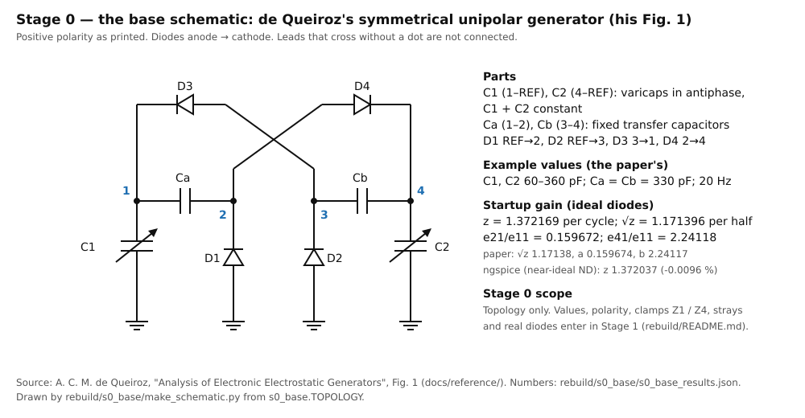

# Stage 0 — the base schematic: findings

**Source:** `rebuild/s0_base/s0_base.py` → `s0_base_results.json` and the deck `s0_base.cir`. The drawing is
`schematic-s0-base.svg`, from `make_schematic.py`. Every number below is from the results file.

**Status:**
- **DECIDED by the designer (2026-10-14):** "this paper's fig. 1 schematic is the new first schematic to create the
  doubler from".
- **Reviewed and frozen (the designer, 2026-10-14: "Schematic ok"):** the freeze commit is recorded in
  `rebuild/README.md`.

## The schematic

**The circuit is de Queiroz's symmetrical unipolar generator (his Fig. 1), drawn as printed, positive polarity.**
[OC: `docs/reference/deQueiroz-2019-analysis-electronic-electrostatic-generators.pdf`]

| part | nodes | role |
|:--|:--|:--|
| C1 | 1 – REF | varicap A, C_max at phase 1 |
| C2 | 4 – REF | varicap B, in antiphase (C1 + C2 constant) |
| Ca | 1 – 2 | fixed transfer capacitor |
| Cb | 3 – 4 | fixed transfer capacitor |
| D1 / D2 | REF → 2 / REF → 3 | the return diodes |
| D3 / D4 | 3 → 1 / 2 → 4 | the cross diodes |

One source, `s0_base.TOPOLOGY`, generates both the netlist and the drawing. Both refuse a topology that differs from
Fig. 1, and so does the ideal solver's circuit (assertions in the scripts).

## The records, with the paper's example values (60–360 pF, Ca = Cb = 330 pF, 20 Hz)

| record | z per cycle | √z per half | e21/e11 | e41/e11 |
|:--|:--|:--|:--|:--|
| the paper (printed) | — | 1.17138 | 0.159674 | 2.24117 |
| ideal diodes, the LCP solver (`sim/queiroz_matrix.py`) | 1.372169 | 1.171396 | 0.159672 | 2.24118 |
| ngspice, near-ideal ND diodes | 1.372037 | — | 0.159811 | 2.24115 |

- **ngspice sits 0.0096 % under the ideal limit** [OC]. Its eigenvector agrees to 1.4 × 10⁻⁴. The lowest node
  voltage is −2.7 mV, ND's forward drop at 0.005 n.
- **The paper's printed √z is 1.6 × 10⁻⁵ low**, as `sim/queiroz-matrix-findings.md` finding 4 records; a and b agree.
- **The seed** sits on the varicaps' nodes 1 and 4 only. Seeding every node alike excites a decaying mode instead
  (`sim/queiroz-matrix-findings.md`, the caveat) [OC].

## What Stage 0 does not settle (carried to Stage 1)

- **The values.** The tube's C1 / C2, Ca / Cb (495 pF, the sixth gap) and the node strays.
- **The polarity: DECIDED positive** (the designer, 2026-10-14: "Positive is ok").
  - The record ran every diode reversed. That is the same machine at negative polarity: z 1.372165 at the same step
    count (`sim/queiroz_matrix_results.json`) [OC].
- **The clamps Z1 / Z4: not assumed.** The designer, 2026-10-14: "I will not even decide if the clamps are necessary.
  We will evaluate this instead of injecting prior work before evidence exists to prove its necessity." S1 sizes the
  bare core and shows what limits its voltage. The clamps, or anything else, enter only if that evidence calls for
  them.
- **Real diodes.**
  - Per the designer's 2026-10-14 decision, the ideal and real-diode records are both kept.
  - The real-diode record waits for the tube's values: an HV stick's leakage at the paper's 150 V scale says nothing
    about the tube [IR].
